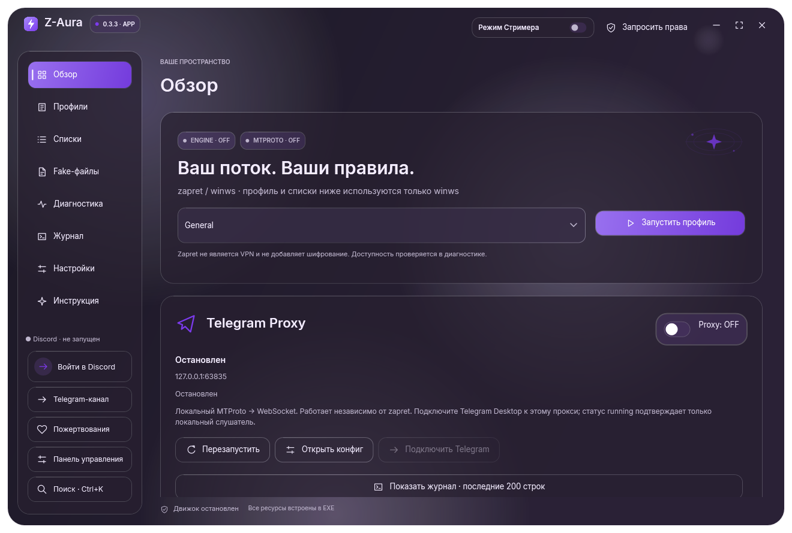
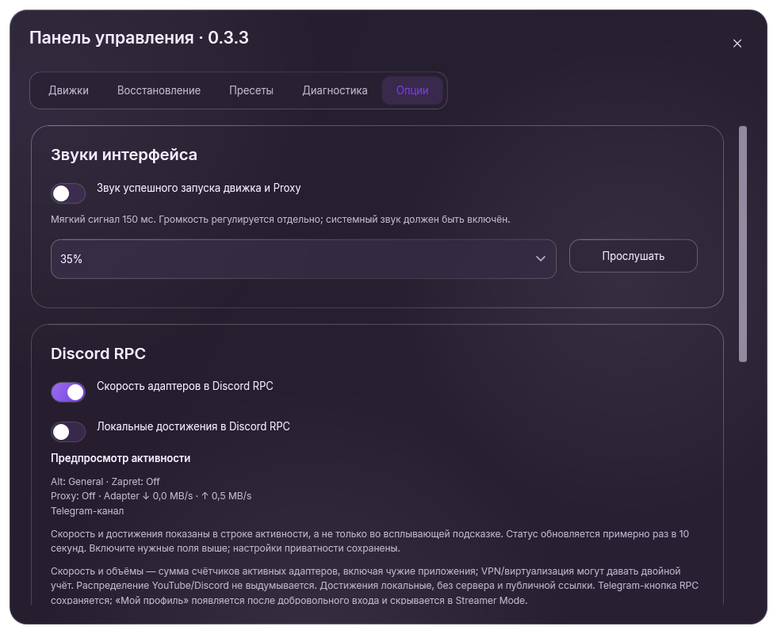

# Z-Aura

Нативный интерфейс для zapret и других движков на **Windows 10/11 x64**, написанный на **.NET 10 / WPF**. Профили, Telegram Proxy, диагностика и настройки собраны в одном EXE со встроенными зависимостями.

**Версия 0.3.3 — исправленный локальный кандидат.** Подготовка этих файлов не означает публикацию релиза. Опубликованные версии: [GitHub Releases](https://github.com/dopebeanie/Z-Aura/releases). Новости: [Telegram · @zaurafork](https://t.me/zaurafork).

Z-Aura **не является VPN**, не скрывает IP и не гарантирует доступность, анонимность или отсутствие утечек. Основные сетевые функции работают без аккаунта; возможности бесплатны.



## Возможности

- **Панель управления:** zapret/winws, ByeDPI, sing-box + ByeDPI и GoodbyeDPI. Все 22 исходные стратегии winws сохранены.
- **Выбор процессов:** EXE-список поддерживается только в sing-box + собственный локальный ByeDPI, для TCP. UDP, QUIC и голос остаются прямыми. Неподдерживаемый выбор EXE не превращается в глобальный перехват winws/GoodbyeDPI.
- **Telegram Proxy:** отдельное управление, конфигурация, порт, uptime и журнал. Python и зависимости встроены; включённый локальный слушатель не гарантирует внешнее соединение.
- **Восстановление:** снимки перед собственными изменениями hosts, DNS и службы, проверка последующих изменений и ограниченный откат. Это не образ Windows и не восстановление произвольных чужих драйверов.
- **Пресеты:** сохранение профиля, движка, процессов, Proxy и необязательного DNS с привязкой к сети; автоприменение включается отдельно.
- **Подбор стратегии:** отменяемое сравнение пяти стратегий по HTTPS-проверкам с отдельным измерением без движка. Результаты не доказывают работу видео или звонков.
- **Режим Стримера:** переключатель скрывает личность Discord, пути, журналы и персональные сведения RPC. Локальные данные на диске не удаляются.
- **Discord RPC:** Telegram-кнопка, необязательная кнопка профиля после входа, отдельно включаемые скорость адаптеров и локальные достижения, предпросмотр активности.
- **Звуки интерфейса:** выключены по умолчанию; включение, громкость и прослушивание в «Панель управления → Опции». Сигнал успешного запуска движка или Proxy — 150 мс.
- **Удобство:** RU/ENG, обе темы, мини-оверлей, единственный экземпляр GUI, локальный ZIP для поддержки, настройки доступности и добровольный автозапуск GUI.

VPN и антивирус автоматически не отключаются. Аварийная блокировка заранее подготовленных IP — добровольная реакция после сбоя; она не гарантирует защиту от всех утечек.

## Исправления 0.3.3

Выровнены кнопки боковой панели; обновлены логотипы приветствия и оверлея; добавлен переключатель «Режим Стримера» с постоянной подписью. «Снимки» переименованы в «Восстановление», Presets — в «Пресеты», Auto-Tune — в «Подбор стратегии». Исправлены прокрутка Опций, прогресс удержания, настройки звука и видимые поля RPC. Полная проверка конфликтов больше не повторяется при каждом запуске профиля.

Подробности: [матрица 14 исправлений](FIXES-0.3.3-UI.md).



## Запуск и данные

1. Получите EXE из доверенного комплекта и сверьте SHA-256. Ссылка Releases может содержать другую опубликованную версию; сверяйте описание и хеш.
2. Сохраните предыдущий EXE и данные; закройте приложение перед ручной заменой.
3. Запустите `Z-Aura.exe`. Production-сборка запрашивает права администратора; установленный .NET не нужен. Цифровой подписи издателя нет.
4. Выберите движок и профиль. Для звуков и дополнительных полей RPC откройте «Панель управления → Опции».

Обычные данные: `%APPDATA%\Z-Aura`. При наличии `portable.flag` рядом с EXE используется папка `data`. Не добавляйте в репозиторий пользовательские настройки, OAuth-сессии, журналы и диагностические ZIP.

Discord OAuth использует `identify`; сохранённая сессия защищена Windows DPAPI для текущего пользователя. Discord, GitHub, Telegram и выбранные relay получают обычные данные соответствующих соединений. Локальный отчёт поддержки не отправляется автоматически; проверяйте его перед передачей.

## Проверки локальной исправленной сборки

| Проверка | Результат |
| --- | --- |
| Backend, включая native console fixture | 2051 assertion |
| GUI, RU/ENG и обе темы | 358 PASS-записей |
| Node | 80/80 тестов |
| Локализация панели | Без пропусков аудита |
| Native launcher / payload / манифесты | Проверены; исполнялся отдельный asInvoker-аналог |

SHA-256 локального production EXE, 131 552 256 байт:

```text
08156c5673d82bfaf32851306ca35a2aa4d82e94a73a7175e0123af466a3e933
```

Автотесты используют изолированные данные. Реальные elevated WinDivert/TUN, изменения и откат DNS/hosts/firewall/службы, чистая Windows, перезагрузка, живой Discord, слышимость на устройстве и работа у конкретного провайдера не объявляются проверенными. Замер 2393 → 109 мс относится только к read-only сбору сведений о драйверах/маршрутах, не ко всему запуску winws.

## Сайт и содержимое комплекта

`website/index.html` — русский сайт, `website/index.en.html` — английский. Логотип и реальные скриншоты находятся в `website/assets/`. Откройте HTML локально либо разместите содержимое `website/` в каталоге публикации статического хостинга. Внешний Google Fonts требует сети; предусмотрены системные шрифты.

Этот ZIP содержит сайт, README, текст Telegram, матрицу исправлений и уведомления. **EXE и исходники приложения в него не включены.** Полный WPF-комплект передан отдельно. README можно положить в корень репозитория, сохранив рядом папку `website/` и `FIXES-0.3.3-UI.md`.

`TELEGRAM-POST.txt` — готовый русский текст для канала, не опубликованный автоматически. `MANIFEST.json` содержит хеши файлов архива.

## Сборка приложения из полного исходного комплекта

Для WPF нужен .NET 10 SDK; для native launcher — LLVM-MinGW. В полном исходном комплекте доступны:

```powershell
powershell -NoProfile -ExecutionPolicy Bypass -File scripts/build-update-0.3.3.ps1 -BuildSuffix my-build
node --test tests/*.test.mjs
node scripts/audit-control-localization.mjs
```

Скрипт требует нового выходного каталога. Исторические web-тесты могут требовать файлы исходного workspace, не входящие в WPF-архив.

## Лицензии и поддержка

Оригинальный GUI и интеграционный код — MIT: [LICENSE](LICENSE). Сторонние компоненты сохраняют свои лицензии: [NOTICE.md](NOTICE.md). MIT не распространяется автоматически на zapret, WinDivert, Cygwin, ByeDPI, sing-box и другие зависимости. Проверка условий распространения и соответствующих исходников остаётся обязательной перед публичным выпуском комбинированной сборки.

Все функции бесплатны. Добровольная поддержка / Donate:

**2202 2085 9236 5168 · СберБанк**

---

**English:** Z-Aura 0.3.3 is a local corrected .NET 10/WPF Windows candidate with bundled engines, Telegram Proxy, scoped recovery, network presets and opt-in Discord RPC. Process selection is supported only through sing-box + owned ByeDPI for TCP; UDP/QUIC/voice stay direct. It is not a VPN. The candidate has not been published by this packaging task. See the [English website](website/index.en.html).
