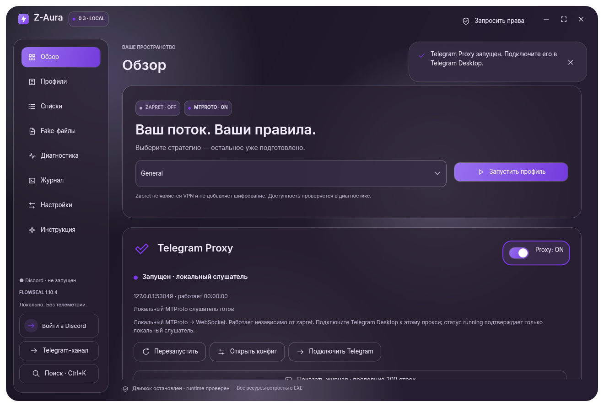
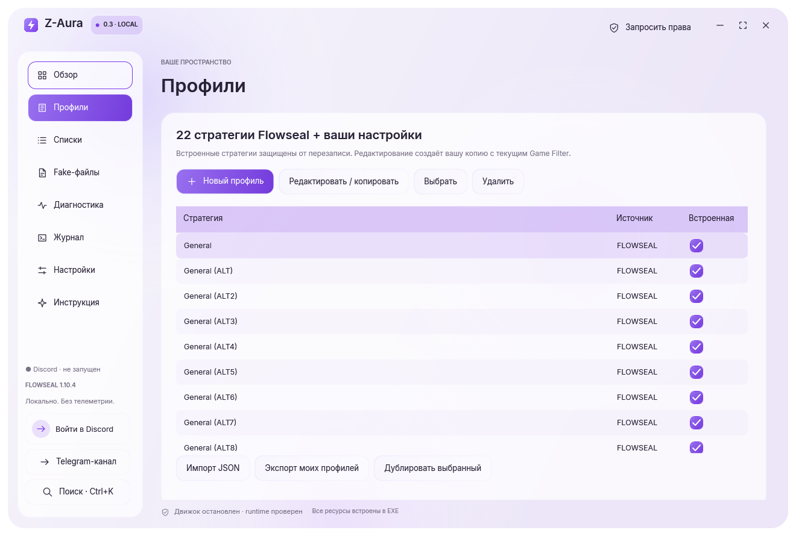
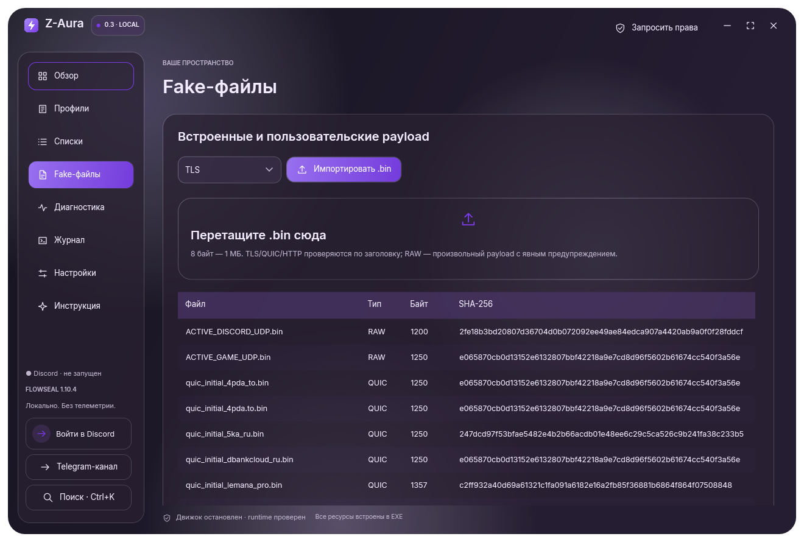
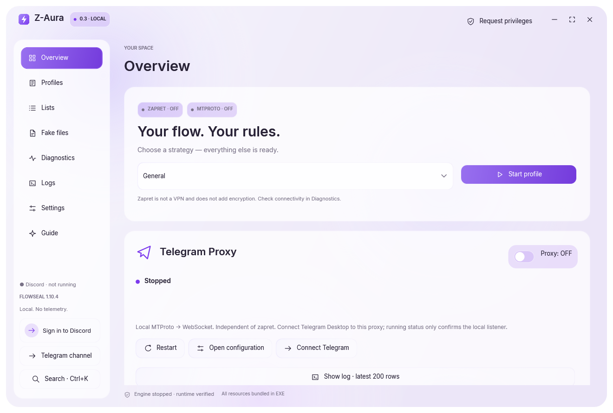
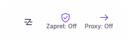
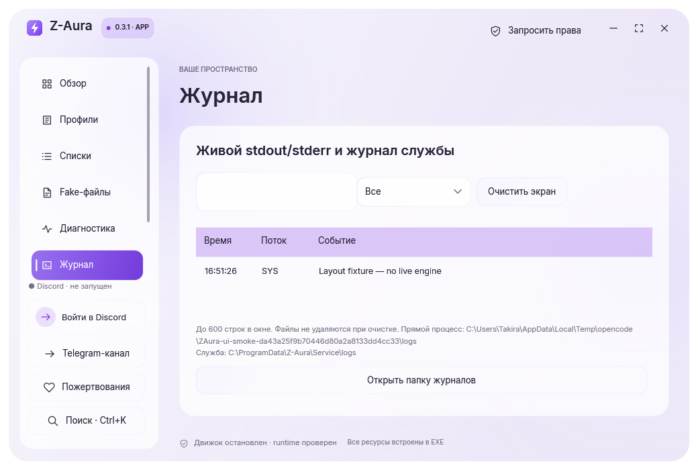
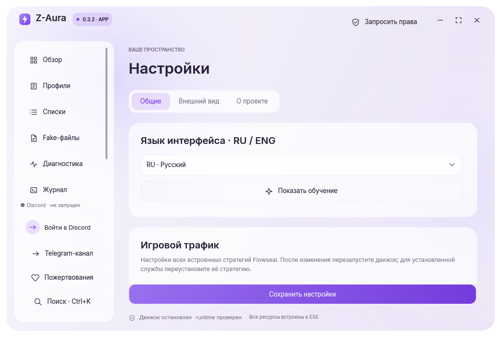

<div align="center">
  
  <h1>Z-Aura</h1>
  <p><strong>Ваш поток. Ваши правила.<br>Your flow. Your rules.</strong></p>
  <p>Нативный интерфейс для zapret · Windows 10/11 x64 · Один portable EXE</p>
  <p>
    
    
    
  </p>
  <p>
    <a href="#ru">Русский</a> · <a href="#en">English</a> ·
    <a href="https://github.com/dopebeanie/Z-Aura/releases">Скачать / Releases</a> ·
    <a href="https://t.me/zaurafork">Telegram · @zaurafork</a>
  </p>
</div>

> **Не VPN.** Z-Aura не скрывает IP, не добавляет VPN-шифрование и не гарантирует анонимность или доступность сайтов.
> **Not a VPN.** Z-Aura does not hide your IP, add VPN encryption or guarantee anonymity or connectivity.

## Новое в Z-Aura 0.3.0 / What's new

**Comfort Update + актуальные исправления интерфейса и Discord Return.**

- **RU / ENG:** язык сохраняется; первый запуск на русском. Пропускаемое обучение и встроенная инструкция.
- **Работа в фоне:** восстановление окна из трея; добровольный мини-оверлей с перетаскиванием и привязкой к краям экрана.
- **Discord внизу меню:** кнопка входа над Telegram-каналом, круглый аватар, имя и `@username` после авторизации. Длинные имена сокращаются, а не переводятся.
- **Страница возврата:** после ответа Discord — локальная страница в стиле Z-Aura и кнопка **«Вернуться в приложение»**. Она восстанавливает уже запущенное окно, без нового процесса или регистрации протокола Windows.
- **Аккуратная компоновка:** исправлены обрезанные края кнопок меню, подпись под таблицей журнала и размеры вкладок «Общие» / «Внешний вид». Навигация прокручивается отдельно от нижних кнопок.
- **YouTube Focus:** обратимая экспериментальная копия профиля с узкими YouTube/CDN-блоками. Исходные 22 стратегии и runtime Flowseal 1.10.4 не заменяются.
- **Остановка zapret:** отдельный помощник проверяет PID, время создания процесса и отсутствие посторонних участников консоли. Telegram Proxy управляется независимо.

**English:** persistent RU/ENG, skippable tutorial, tray restore and optional mini overlay;
Discord profile in the lower sidebar, an offline local return page with a **Return to the app**
button, and corrected navigation/log/settings layouts. Original 22 strategies remain intact.

> **Статус: кандидат обновления / test candidate.** README описывает текущую локальную сборку,
> а не подтверждает её публикацию на GitHub. Живой OAuth, реальное видео, elevated driver/service
> и чистая Windows ещё требуют проверки. `Proxy: On` означает готовый локальный слушатель,
> не гарантированное подключение к Telegram.

## Интерфейс / Interface

| Светлая тема / Light theme | Тёмная тема / Dark theme |
| :---: | :---: |
|  |  |
| **Telegram Proxy · светлая тема** | **Telegram Proxy · тёмная тема** |
|  |  |
| **Профили / Profiles** | **Fake-файлы / Fake files** |
|  |  |
| **English UI** | **Мини-оверлей / Mini overlay** |
|  |  |
| **Журнал · минимальное окно** | **Настройки · минимальное окно** |
|  |  |

<sub>Снимки настоящего WPF-интерфейса из автоматических проверок. Данные и состояния тестовые;
скриншоты не подтверждают живое подключение к Discord, Telegram или обход DPI.</sub>

<a id="ru"></a>
## Русский

**Z-Aura** — независимый Windows-интерфейс для управления zapret на базе
[Flowseal/zapret-discord-youtube 1.10.4](https://github.com/Flowseal/zapret-discord-youtube).
Выбирайте стратегии, редактируйте списки и создавайте профили без ручного запуска bat-файлов.

### Возможности

| Раздел | Что доступно |
| :--- | :--- |
| Профили | 22 встроенные стратегии; копирование, редактирование, импорт/экспорт JSON, привязка ресурсов к блокам. |
| Списки и fake-файлы | Домены, IP и исключения; поиск, проверка, импорт/экспорт и удаление дублей; библиотека payload-файлов с SHA-256. |
| Game Filter | Четыре режима и пользовательские диапазоны портов. |
| Диагностика | Журнал и HTTPS-проверки по запросу пользователя; не тест QUIC или скорости видео. |
| Помощь с подключением | DNS/TLS → предпросмотр hosts → добровольное применение с копией и откатом только блока Z-Aura. |
| Telegram Proxy | Независимые ON/OFF, перезапуск, конфиг, порт, uptime и журнал; MTProto → WebSocket на базе Flowseal. |
| Discord Presence | Alt + Zapret On/Off + Proxy On/Off, время работы приложения, канал и необязательная кнопка «Мой Alt». |
| Discord-профиль | Добровольный browser OAuth с PKCE и `identify`; аватар и имя в нижнем меню, локальная страница возврата. |
| Интерфейс | RU/ENG, светлая/тёмная тема, Ctrl+K, инструкция, обучение, трей и мини-оверлей; уменьшение движения/прозрачности и высокий контраст. |
| Служба Windows | Управление отдельной постоянной копией; служба может продолжать работу без GUI. |

### Скачать и начать

1. Откройте [GitHub Releases](https://github.com/dopebeanie/Z-Aura/releases) и скачайте EXE нужной версии. Проверьте SHA-256, указанный именно для этого файла.
2. Поместите EXE в папку с разрешённой записью. Установщик и отдельные .NET/Python не нужны — зависимости встроены.
3. Запустите Z-Aura. Production-сборка запрашивает права администратора при запуске: они нужны для движка/службы.
4. Выберите стратегию и нажмите **«Запустить профиль»**. Если доступа нет, попробуйте другой ALT и посмотрите журнал.
5. Для Telegram отдельно включите **Telegram Proxy** и нажмите **«Подключить Telegram»**. Изменения его конфигурации применяются после перезапуска прокси.

Закрытие в трей не равно завершению приложения. Остановка zapret не выключает Telegram Proxy;
для полного выхода используйте команду выхода из приложения. Установленная служба имеет отдельный жизненный цикл.
Не отключайте антивирус, Secure Boot или проверку подписи драйверов ради запуска.

### Вход через Discord

- **Вход доступен обычным пользователям, не только автору Z-Aura.** Каждый подтверждает доступ к своему публичному профилю в браузере; доступа к Developer Portal ему не нужно.
- Кнопка находится внизу левой панели, **над Telegram-каналом**. После входа здесь показываются аватар, имя и `@username`; нажатие открывает выход из профиля.
- Z-Aura запрашивает только **`identify`**, без email, серверов, друзей и сообщений. Пароль, bot token и Client Secret в приложение не вводятся.
- После ответа Discord локальная страница предлагает вернуться в Z-Aura. Кнопка доступна 90 секунд; если окно не появилось, откройте его через значок в трее. Результат входа показывается в приложении, не объявляется страницей автоматически.
- `127.0.0.1` ведёт на компьютер самого пользователя. Страница, логотип и шрифт встроены в EXE; хостинг, аналитика и внешние ресурсы страницы не нужны.
- Токен, профиль и аватар остаются в памяти, не сохраняются на диск и очищаются при выходе/истечении сеанса. После завершения Z-Aura нужен новый вход. Аватар загружается с Discord CDN без bearer-токена и дискового кэша; при ошибке остаётся локальная иконка.

<details>
<summary><strong>Владельцу приложения: Redirect URI и ошибка «некорректный redirect_uri»</strong></summary>

В [Developer Portal](https://discord.com/developers/applications/1573957957576556685/oauth2)
для приложения **1573957957576556685** откройте **OAuth2 → Redirects**, добавьте и сохраните:

```text
http://127.0.0.1:43827/oauth/callback
```

Точный `http`, IP, порт и путь, **без `/` в конце**. Это не поле Interactions Endpoint
и не адрес Terms/Privacy. После сохранения отмените старую попытку и начните вход заново.
Один зарегистрированный URI подходит всем пользователям: listener работает у каждого локально.
S256 PKCE позволяет обмен кода без Client Secret; refresh token Z-Aura не сохраняет и не обновляет.
Public Bot не относится к этому входу. Живой вход вторым аккаунтом ещё не проверен.

</details>

### Данные, Presence и ограничения

- По умолчанию данные находятся в **`%APPDATA%\Z-Aura`**. Для хранения рядом с EXE создайте пустой **`portable.flag` до запуска** — приложение использует соседнюю папку `data`. Смена режима не переносит данные автоматически.
- Перед обновлением закройте GUI и сохраните прежние `portable.flag` / `data`. Не удаляйте пользовательские данные вместе со старым EXE. Служба использует `%ProgramData%\Z-Aura\Service`.
- **Presence всегда работает, пока запущена Z-Aura, независимо от входа.** Для отображения нужен desktop-клиент Discord; видимость регулируется его настройками активности. Имя профиля ALT может быть опубликовано — не включайте в него личные сведения.
- Необязательные RPC-счётчики — запуски GUI-zapret/Proxy и HTTPS-проверки за текущий сеанс, не трафик, скорость или успешность обхода. Их можно скрыть, не отключая Presence. Имя Discord-аккаунта в RPC не отправляется.
- Нет автоматической отправки журналов/профилей разработчику. Это не означает отсутствие сети: Presence обращается к Discord IPC, OAuth/CDN — к Discord, прокси — к Telegram/выбранным relay, диагностика — к проверяемым сайтам.
- Secret Telegram Proxy хранится в локальных настройках, скрывается в логах и не попадает в Presence. CF-relay применяется по конфигурации пользователя; обновление списка доменов с GitHub отключено.
- YouTube Focus экспериментален, не переключает уже работающий движок автоматически и не гарантирует доступность видео. Hosts-мастер не обязателен, не обходит защиту Windows; его резервные копии могут содержать частные адреса.
- SHA-256 проверяет целостность, **не является цифровой подписью**. Подпись издателя, требования распространения сторонних компонентов и live/system acceptance требуют отдельной проверки перед общедоступным выпуском.

<a id="en"></a>
## English

**Z-Aura** is an independent native Windows GUI for zapret, based on Flowseal 1.10.4 and
its 22 strategies. It includes custom profiles, domain/IP/exclusion editors, a fake-payload
library, Game Filter, on-demand diagnostics and an opt-in DNS/hosts wizard.

**Telegram Proxy** is bundled and independently controlled. **Discord Presence** shows
Alt + Zapret On/Off + Proxy On/Off with an application-lifetime timer and reconnects;
it stays active without profile authorization. Optional counters describe session starts/checks,
not bandwidth or bypass success.

### Getting started

1. Download your selected build from [Releases](https://github.com/dopebeanie/Z-Aura/releases) and verify its exact SHA-256.
2. Put the EXE in a writable folder. No installer, separately installed .NET/Python, WebView2 or NSSM is required.
3. Launch it and accept the production build's administrator prompt if you trust the source.
4. Select a strategy and click **Start profile**; try another ALT and check logs if needed.
5. Enable **Telegram Proxy** separately and use **Connect Telegram**. Configuration edits require a proxy restart.

Choose ENG in Welcome or Settings. The language is saved; first launch defaults to Russian.
Tray operation, a skippable tutorial, an optional draggable/snapping overlay and accessibility
modes are available. Stopping zapret does not stop Telegram Proxy; installed services have
their own lifecycle. Never disable Windows security protections to run the app.

### Discord sign-in and return

Ordinary users can authorize their own account using browser OAuth/S256 PKCE and `identify`
only; there is no owner allowlist and no password/Client Secret in the EXE. The app owner must
register **`http://127.0.0.1:43827/oauth/callback`** once in Developer Portal. Users need only
a running local Z-Aura and access to Discord, not Developer Portal permissions.

The sign-in button sits above the Telegram channel in the lower sidebar. After authorization
it shows a round avatar, display name and `@username`. The bundled RU/ENG return page offers
**Return to the app**, restoring the existing GUI without a new process or Windows URL protocol.
The button lasts 90 seconds; use the tray icon if focus is denied or the listener has expired.
Sign-in success/failure stays in the GUI. Live OAuth with another account remains unverified.

Tokens/profile/avatar stay in memory only; no refresh token is retained. CDN avatar fetches
use no bearer header or disk cache. Account identity is not sent to Rich Presence.
The local page has no scripts, analytics, external assets or hosting requirement.

### Storage and privacy

Default storage: `%APPDATA%\Z-Aura`. An empty adjacent `portable.flag` selects `./data`;
switching modes does not migrate data. Preserve your settings/data when replacing an EXE.
The service uses a persistent copy under `%ProgramData%\Z-Aura\Service`.

Profiles/logs are not automatically uploaded to the developer, but Discord, proxy and
user-triggered diagnostic operations still make their required connections. Avoid sensitive
ALT profile names in Presence; redact secrets/private addresses from logs and hosts backups.
YouTube Focus and hosts samples are experimental, not universal connectivity fixes.
Publisher signing, redistribution/source obligations and clean-Windows/live driver/service
acceptance still need review.

## Разработчикам / Development

Current desktop: **.NET 10 / WPF + native C bootstrap (LLVM-MinGW)**. React/Tauri in
`src` / `src-tauri` is a separate prototype, not the shipping EXE.

Build requirements: Windows x64, .NET SDK 10.0.x with WindowsDesktop, Node 24+ and
`tools/llvm-mingw-20261117-msvcrt-x86_64`. Pinned local inputs are in `upstream` and
`desktop/Z-Aura/assets`; retain them and dependency caches for offline builds.

```powershell
# After initial dependency restore/setup; do not overwrite a running EXE.
node scripts/build-portable.mjs --output-dir artifacts/portable-discord-return
node scripts/verify-portable.mjs --artifact-dir artifacts/portable-discord-return
node --test tests/*.test.mjs
dotnet run --project scripts/localization-audit -- "$PWD"
```

**Current local candidate:** `artifacts/portable-discord-return/Z-Aura.exe` · **0.3.0.0** ·
**96 256 000 bytes / 91.80 MiB**.

```text
SHA-256 e29b5513bff0c8e6a652573d5588711d6b57f378179182140b882b6159218e5e
```

Latest checks: **1,586 backend assertions**, **248 GUI PASS records** (RU/ENG, normal/minimum
sizes, isolated HTTP return restoring a hidden/minimized WPF window), **56 Node tests** (including documentation) and
**609 localization fragments**. The self-contained unprivileged test payload also passed
1,586 assertions with an invalid `DOTNET_ROOT`. These fixtures do **not** establish live
OAuth/Telegram, real ISP/video, elevated winws/hosts/service/reboot or clean-Windows acceptance.
Tests are recorded for this candidate, not automatically for later rebuilds.

- [Current verification](https://github.com/dopebeanie/Z-Aura/blob/HEAD/docs/DESKTOP-VERIFICATION.md)
- [Comfort Update, Discord return/security and owner setup](https://github.com/dopebeanie/Z-Aura/blob/HEAD/docs/COMFORT-UPDATE.md)
- [Desktop architecture and build](https://github.com/dopebeanie/Z-Aura/blob/HEAD/docs/DESKTOP-PORTABLE.md)
- [Telegram Proxy](https://github.com/dopebeanie/Z-Aura/blob/HEAD/docs/TELEGRAM-PROXY.md) · [Discord Presence](https://github.com/dopebeanie/Z-Aura/blob/HEAD/docs/DISCORD-PRESENCE.md)
- [DNS/hosts wizard](https://github.com/dopebeanie/Z-Aura/blob/HEAD/docs/HOSTS-REPAIR.md)
- [Telegram announcement · plain text](https://github.com/dopebeanie/Z-Aura/blob/HEAD/docs/TELEGRAM-POST-0.3.txt)

## Авторы и лицензии / Credits and licensing

**@dopebeanie / TC Studio** · [Telegram](https://t.me/zaurafork) ·
[Issues](https://github.com/dopebeanie/Z-Aura/issues) · [z-aura@internet.ru](mailto:z-aura@internet.ru)

Independent project; not an official Discord, Flowseal or zapret product.
Original Z-Aura code is [MIT](https://github.com/dopebeanie/Z-Aura/blob/HEAD/LICENSE); this does not relicense bundled third-party components.
Keep their licenses/notices and comply with applicable corresponding-source obligations:
[NOTICE.md](https://github.com/dopebeanie/Z-Aura/blob/HEAD/NOTICE.md).

[Flowseal zapret](https://github.com/Flowseal/zapret-discord-youtube) ·
[Flowseal tg-ws-proxy](https://github.com/Flowseal/tg-ws-proxy) ·
[bol-van/zapret](https://github.com/bol-van/zapret) ·
[WinDivert](https://reqrypt.org/windivert.html) · [Inter](https://rsms.me/inter/)

[Terms](https://dopebeanie.github.io/cl3j1hdh7dbb2dzx/terms.html) ·
[Privacy](https://dopebeanie.github.io/cl3j1hdh7dbb2dzx/privacy.html)
— legal pages require updated OAuth/statistics disclosure review before distributing this candidate.
