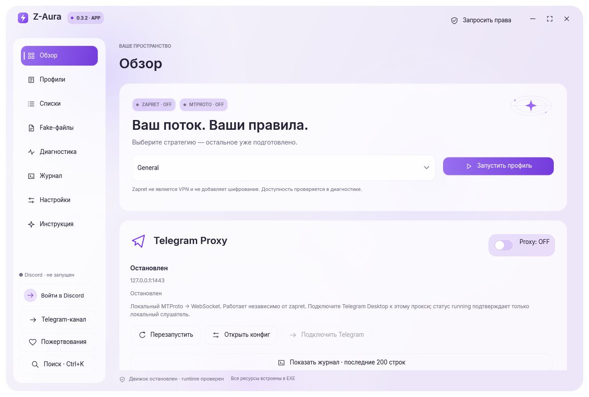
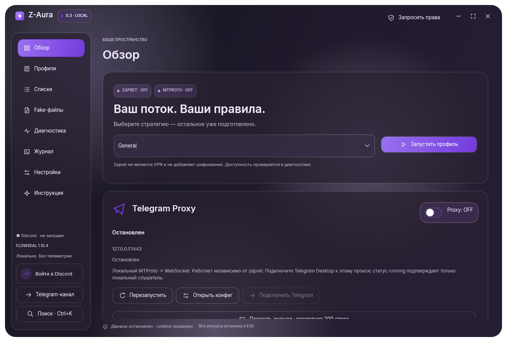
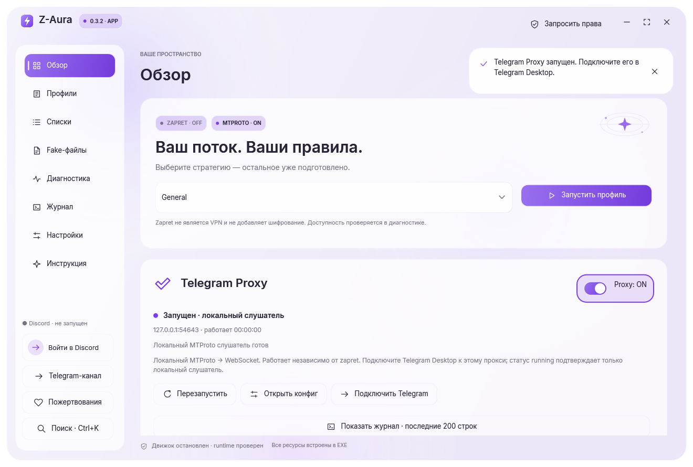

<div align="center">
  
  <h1>Z-Aura</h1>
  <p><strong>Ваш поток. Ваши правила.<br>Your flow. Your rules.</strong></p>
  <p>Нативный Windows-интерфейс для zapret · Native Windows UI for zapret</p>
  <p>
    
    
    
  </p>
  <p>
    <a href="#ru">Русский</a> ·
    <a href="#en">English</a> ·
    <a href="#screenshots">Скриншоты / Screenshots</a> ·
    <a href="https://dopebeanie.github.io/Z-Aura/">Сайт / Website</a> ·
    <a href="https://t.me/zaurafork">Telegram · @zaurafork</a>
  </p>
  <p>
    <a href="https://github.com/dopebeanie/Z-Aura/releases/latest/download/Z-Aura.exe"><strong>↓ Скачать / Download Z-Aura.exe</strong></a>
    &nbsp; · &nbsp;
    <a href="https://github.com/dopebeanie/Z-Aura/releases">Все релизы / All releases</a>
  </p>
</div>

---

## Новое в Z-Aura / What's new

**Telegram теперь внутри. Больше контроля — без лишних установок.**

- **Встроенный Telegram Proxy** на базе Flowseal: работает независимо от zapret;
  ON/OFF, перезапуск, порт, время работы и журнал в отдельной стеклянной карточке.
- **Конфиг прямо в GUI:** редактирование параметров с проверкой ошибок,
  подключение Telegram Desktop через MTProto-ссылку.
- **Один portable EXE:** Python и зависимости включены; runtime не скачивается при запуске.
- **Обновлённая Discord Presence:** `Alt + Zapret On/Off + Proxy On/Off`, таймер на всё
  время работы приложения и автоматическое переподключение. Discord-настройки из Z-Aura удалены.
- **Мы в Telegram:** [@zaurafork](https://t.me/zaurafork) — новости, changelog и анонсы.
  Ссылка доступна в приложении и Presence; необязательная кнопка «Мой Alt» сохранена.

**English:** bundled independent Telegram Proxy with ON/OFF, restart, uptime/logs and
a validated GUI config editor; embedded Python with no runtime downloads; Presence
shows Alt, Zapret and Proxy with a stable session timer and automatic reconnect.
Discord settings are removed. Follow [@zaurafork](https://t.me/zaurafork) for updates.

> Это тестовый кандидат обновления, не объявление уже опубликованного релиза.
> `Proxy: On` означает готовый локальный слушатель, не гарантирует доступность Telegram.
> Live Telegram/Discord и чистая Windows ещё требуют проверки.<br>
> This update is a test candidate, not a claim that a release is already published.
> Proxy On confirms a local listener, not Telegram connectivity. Live/clean-Windows checks remain pending.

---

<a id="screenshots"></a>
## Интерфейс / Interface

| Светлая тема / Light theme | Тёмная тема / Dark theme |
| :---: | :---: |
|  |  |
| **Профили / Profiles** | **Fake-файлы / Fake payloads** |
|  |  |
| **Telegram Proxy · Light** | **Telegram Proxy · Dark** |
|  |  |

<sub>Снимки настоящего WPF-интерфейса из UI-проверки; состояние и данные демонстрационные. Интерфейс приложения сейчас на русском.<br>Captures of the real WPF interface from UI tests; state and data are illustrative. The application UI is currently in Russian.</sub>

---

<a id="ru"></a>
## Русский

**Z-Aura** — Windows-приложение для управления zapret на базе **Flowseal/zapret-discord-youtube 1.10.4**. Выбирайте стратегии, редактируйте списки и создавайте собственные профили через интерфейс — без ручного запуска bat-файлов.

### Возможности

| | Что доступно |
| :--- | :--- |
| **22 стратегии** | Встроенные режимы Flowseal и быстрое переключение выбранного профиля. |
| **Свои профили** | Создание, копирование, импорт и экспорт JSON; параметры и ресурсы для блоков стратегии. |
| **Списки** | Домены, IP и исключения: поиск, редактирование, импорт, экспорт и удаление дублей. |
| **Fake-библиотека** | Встроенные и пользовательские payload-файлы, просмотр метаданных и SHA-256. |
| **Game Filter** | Четыре режима фильтрации игрового трафика и пользовательские диапазоны портов. |
| **Диагностика** | Журнал движка и HTTPS-проверки, запускаемые пользователем. |
| **Работа в фоне** | Трей и управление службой Windows из приложения; служба может работать без открытого GUI. |
| **Интерфейс** | Светлая/тёмная тема, стеклянное оформление, Ctrl+K, уменьшение движения и прозрачности, высокий контраст. |
| **Telegram Proxy** | Независимые ON/OFF, конфиг, перезапуск, порт, uptime и журнал; MTProto → WebSocket. |
| **Discord Rich Presence** | Alt, Zapret On/Off, Proxy On/Off, время сеанса и кнопка нашего Telegram-канала. |

### Скачать и запустить

1. Скачайте **[Z-Aura.exe](https://github.com/dopebeanie/Z-Aura/releases/latest/download/Z-Aura.exe)** из последнего опубликованного релиза.
2. Поместите файл в папку, где разрешена запись. Установщик и отдельно установленный .NET не нужны: runtime и ресурсы встроены.
3. Запустите приложение. Для работы движка и службы нужны права администратора; текущая production-сборка запрашивает их при запуске.
4. Выберите стратегию и нажмите **«Запустить профиль»**.
5. Если доступа нет, попробуйте другой профиль и проверьте журнал/диагностику — универсальная стратегия для всех провайдеров не гарантируется.
6. Для Telegram включите **Telegram Proxy** отдельно и нажмите **«Подключить Telegram»**.
   Прокси слушает только локальный адрес; изменения конфигурации применяются после его перезапуска.

**Платформа:** Windows 10/11 x64. Отдельные Python, .NET, WebView2, NSSM и Discord SDK не требуются. Для Presence нужен запущенный desktop-клиент Discord; для Telegram и диагностики — сеть.

**Следить за обновлениями:** [Telegram · @zaurafork](https://t.me/zaurafork).

> Если ссылка скачивания возвращает 404, релиз ещё не опубликован либо к нему не прикреплён файл с точным именем `Z-Aura.exe`. Откройте [список релизов](https://github.com/dopebeanie/Z-Aura/releases).

### Портативное хранение

По умолчанию настройки, журналы и кэш находятся в `%APPDATA%\Z-Aura`. Чтобы хранить их рядом с EXE, **до запуска** создайте пустой файл `portable.flag`:

```text
Z-Aura/
├── Z-Aura.exe
├── portable.flag
└── data/              ← создаётся приложением
```

Смена режима не переносит прежние данные автоматически. Установленная служба использует отдельную постоянную копию в `%ProgramData%\Z-Aura\Service`; закрытие GUI не обязательно останавливает службу.

### Важно знать

- **Это не VPN.** Z-Aura не скрывает IP, не добавляет шифрование и не гарантирует анонимность. Используйте приложение только там, где это законно и разрешено правилами вашей сети.
- **Presence работает всегда, пока открыт Z-Aura**, включая сворачивание в трей. Отдельного переключателя нет. Имя выбранного профиля может попасть в активность Discord — не включайте в него личные сведения. Видимость регулируется настройками активности Discord.
- Профили и журналы не отправляются разработчику автоматически. Presence передаётся клиенту Discord через локальный IPC; пользовательская диагностика обращается к проверяемым сайтам.
- Telegram Proxy подключается к Telegram endpoint-ам; CF-relay включается только по выбору пользователя.
  Secret хранится в локальных настройках, скрывается в журнале и не передаётся в Presence.
- SHA-256 проверяет целостность, но не заменяет подпись издателя. Сверяйте хэш конкретного файла с данными его релиза. Не отключайте антивирус, Secure Boot или проверку подписи драйверов.
- Текущая сборка — кандидат на выпуск. Проверки на чистой Windows, службы/драйвера и перезагрузки, подпись издателя и требования распространения сторонних компонентов ещё требуют отдельной проверки перед общедоступным выпуском.

### Авторы и лицензии

Z-Aura — независимый GUI-проект; он не является официальным продуктом Discord, Flowseal или авторов zapret. Оригинальный код Z-Aura имеет лицензию MIT; это **не перелицензирует** zapret, WinDivert, Cygwin, .NET, шрифты или стратегии Flowseal. При публикации составного EXE необходимо соблюдать их лицензии, уведомления и применимые требования о предоставлении исходного кода.

**Основа:** [Flowseal/zapret-discord-youtube](https://github.com/Flowseal/zapret-discord-youtube) · [Flowseal/tg-ws-proxy](https://github.com/Flowseal/tg-ws-proxy) · [bol-van/zapret](https://github.com/bol-van/zapret) · [WinDivert](https://reqrypt.org/windivert.html) · [Inter](https://rsms.me/inter/).

---

<a id="en"></a>
## English

**Z-Aura** is a Windows desktop interface for zapret, based on **Flowseal/zapret-discord-youtube 1.10.4**. Choose strategies, edit lists and create custom profiles without manually running batch scripts. The README is bilingual; the desktop UI is currently Russian.

### Features

| | What you get |
| :--- | :--- |
| **22 strategies** | Built-in Flowseal modes and quick selected-profile switching. |
| **Custom profiles** | Create, duplicate, import and export JSON; configure arguments and per-block resource bindings. |
| **List editor** | Domains, IP addresses and exclusions: search, edit, import, export and deduplicate. |
| **Fake library** | Built-in and custom payload files with metadata and SHA-256 inspection. |
| **Game Filter** | Four game-traffic modes and custom port ranges. |
| **Diagnostics** | Engine logs and user-triggered HTTPS availability checks. |
| **Background operation** | System tray and Windows service management; the service can run without the GUI. |
| **Appearance** | Light/dark glass themes, Ctrl+K actions, reduced motion/transparency and high contrast. |
| **Telegram Proxy** | Independent ON/OFF, configuration, restart, port, uptime and logs; MTProto → WebSocket. |
| **Discord Rich Presence** | Alt, Zapret On/Off, Proxy On/Off, elapsed time and our Telegram channel button. |

### Download and run

1. Download **[Z-Aura.exe](https://github.com/dopebeanie/Z-Aura/releases/latest/download/Z-Aura.exe)** from the latest published release.
2. Place it in a writable folder. No installer or separately installed .NET runtime is needed: runtime and resources are embedded.
3. Launch the app. Engine/service operations require administrator rights; the current production build requests elevation at startup.
4. Select a strategy and click **«Запустить профиль»** (Run profile).
5. If a site remains unavailable, try another profile and check logs/diagnostics. No single strategy is guaranteed to work for every ISP.
6. For Telegram, enable **Telegram Proxy** separately and click **«Подключить Telegram»**.
   Only loopback bind addresses are accepted; configuration edits require a proxy restart.

**Platform:** Windows 10/11 x64. No separately installed Python, .NET, WebView2, NSSM or Discord SDK is required. Presence needs desktop Discord; Telegram and diagnostics need network access.

**Follow updates:** [Telegram · @zaurafork](https://t.me/zaurafork).

> A 404 download usually means there is no published release yet, or its asset is not named exactly `Z-Aura.exe`. Check [all releases](https://github.com/dopebeanie/Z-Aura/releases).

### Portable storage

By default, settings, logs and cache live in `%APPDATA%\Z-Aura`. Create an empty `portable.flag` next to the EXE **before launch** to use the adjacent `data` folder instead. Changing modes does not migrate old data automatically. The installed service uses a separate persistent copy in `%ProgramData%\Z-Aura\Service`; closing the GUI does not necessarily stop it.

### Before you use it

- **Not a VPN:** Z-Aura does not hide your IP, add encryption or guarantee anonymity. Follow applicable laws and your network's rules.
- **Presence is always active while the GUI runs**, including when minimized to the tray. There is no in-app toggle. Selected profile names may be shared as Discord activity; avoid sensitive information. Discord's own activity settings control visibility.
- Local profiles/logs are not automatically uploaded to the developer. Presence uses local Discord IPC; user-triggered diagnostics contact the tested websites.
- Telegram Proxy connects to Telegram endpoints; third-party CF relays are opt-in.
  The secret stays in local settings, is redacted from logs and is never included in Presence.
- SHA-256 checks integrity, not publisher identity. Compare your exact file with the hash supplied in its release. Do not disable antivirus, Secure Boot or driver-signature enforcement.
- The current build is a release candidate. Clean-Windows, live service/driver/reboot validation, publisher signing and third-party redistribution requirements still need separate review before a public release.

### Credits and licensing

Z-Aura is an independent GUI project, not an official Discord, Flowseal or zapret product. Original Z-Aura code is MIT-licensed; this **does not relicense** zapret, WinDivert, Cygwin, .NET, fonts or Flowseal strategies. Distributing the combined EXE requires compliance with their licenses, notices and applicable corresponding-source obligations.

**Built on:** [Flowseal/zapret-discord-youtube](https://github.com/Flowseal/zapret-discord-youtube) · [Flowseal/tg-ws-proxy](https://github.com/Flowseal/tg-ws-proxy) · [bol-van/zapret](https://github.com/bol-van/zapret) · [WinDivert](https://reqrypt.org/windivert.html) · [Inter](https://rsms.me/inter/).

---

<div align="center">
  <p><strong>Август / @dopebeanie (wannadie2day)</strong></p>
  <p><a href="https://t.me/zaurafork"><strong>Telegram-канал Z-Aura · @zaurafork</strong></a></p>
  <p><a href="mailto:z-aura@internet.ru">z-aura@internet.ru</a> · <a href="https://github.com/dopebeanie/Z-Aura/issues">Issues</a> · <a href="https://dopebeanie.github.io/cl3j1hdh7dbb2dzx/terms.html">Условия / Terms</a> · <a href="https://dopebeanie.github.io/cl3j1hdh7dbb2dzx/privacy.html">Конфиденциальность / Privacy</a></p>
  <p><sub>При обращении приложите версию, выбранный профиль и текст ошибки. Удалите секреты и личные данные из журналов.<br>When reporting an issue, include the version, selected profile and error. Remove secrets and personal data from logs.</sub></p>
</div>
